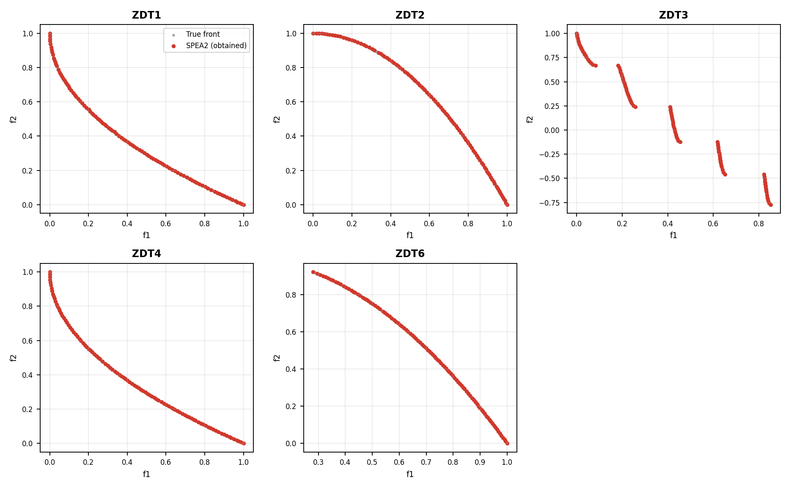
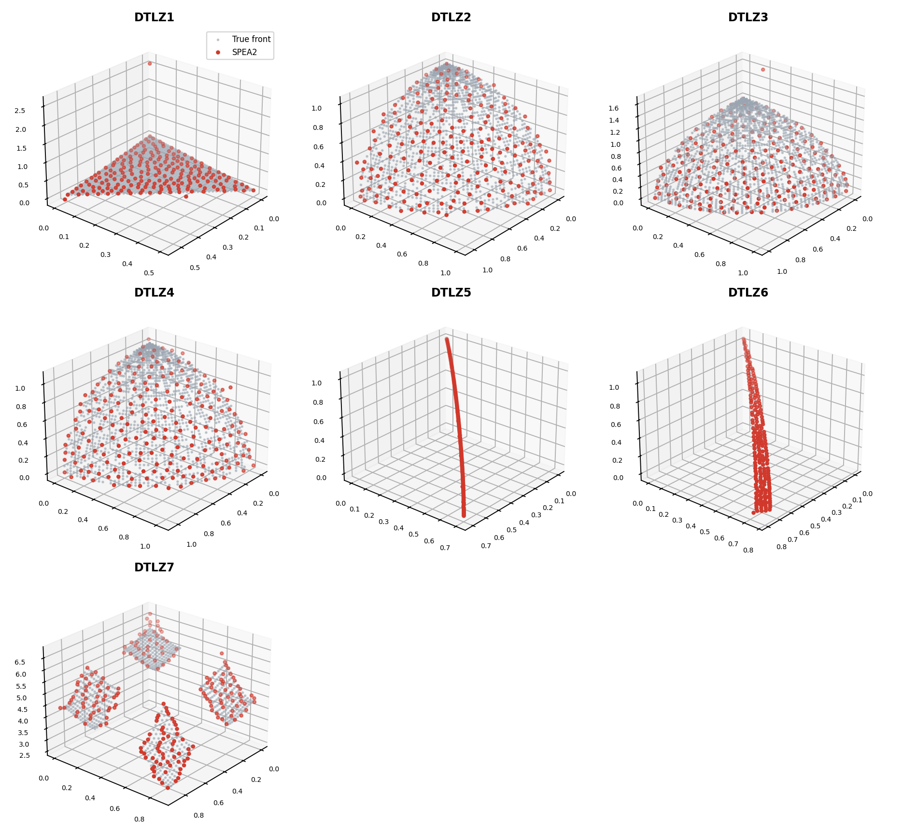
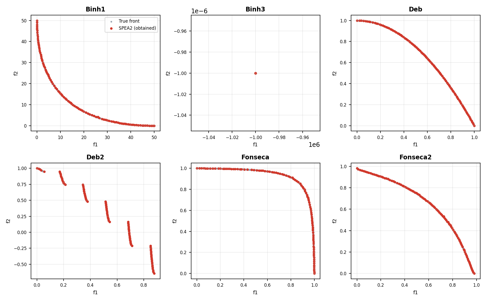
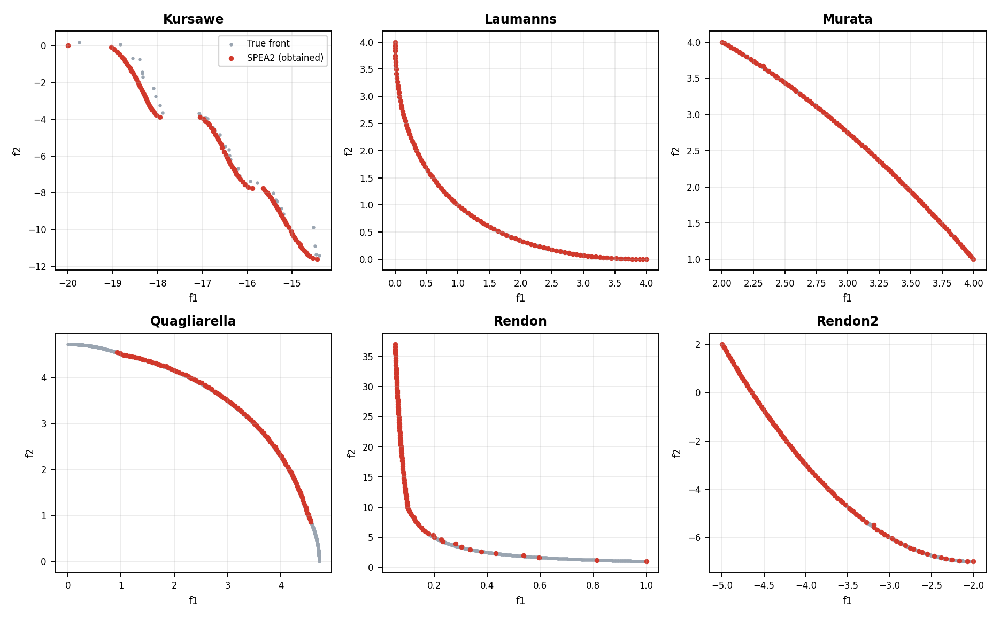
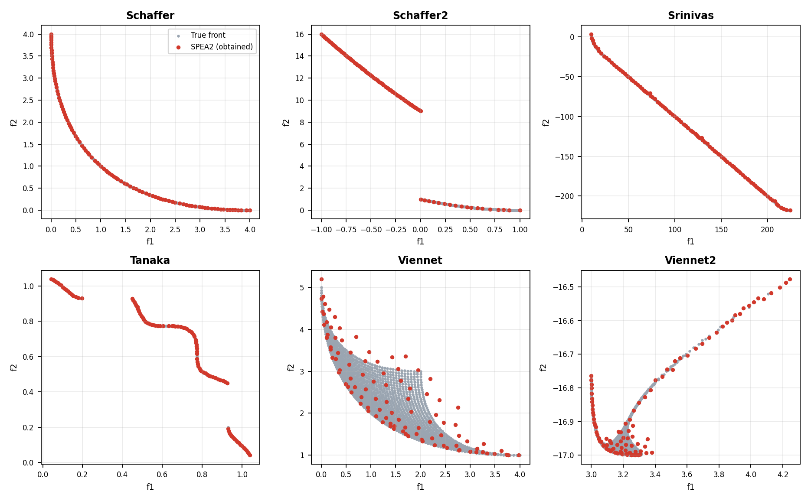
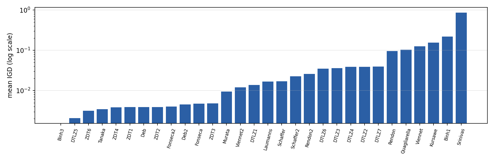
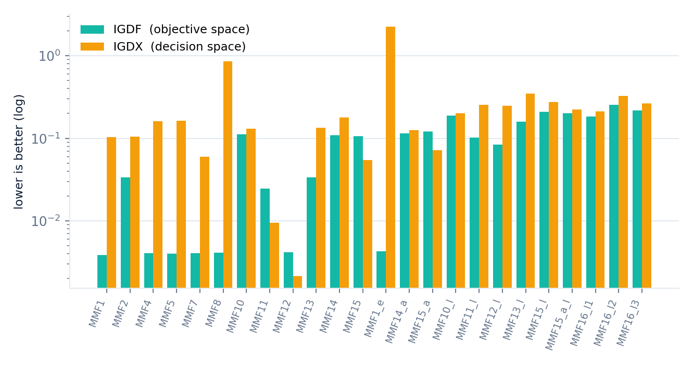
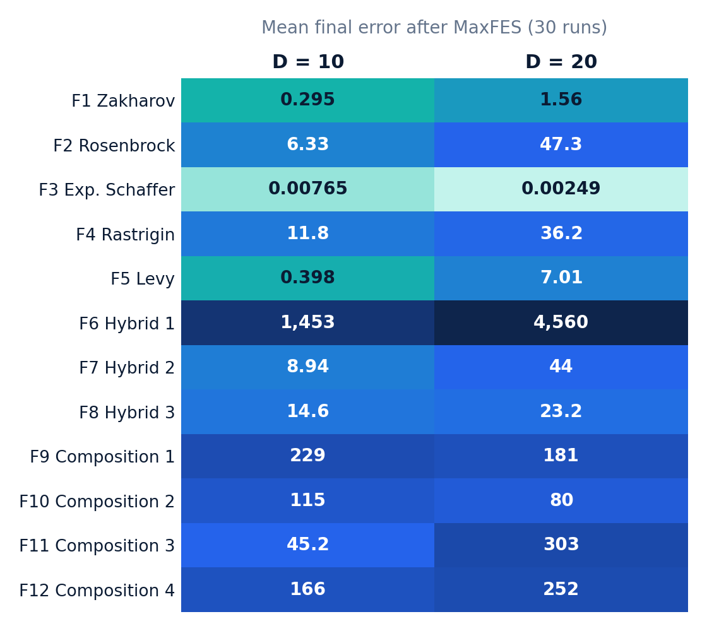

<div align="center">


# Multi-Objective Optimization with SPEA2

### Implementation and Benchmarking on Standard, CEC 2020 MMO and CEC 2022 Suites

**Indian Institute of Technology (Indian School of Mines) Dhanbad**<br/>
Department of Computer Science and Engineering

**Charan Sivuku** &nbsp;·&nbsp; Under the guidance of **Prof. Haider Banka** &nbsp;·&nbsp; 13 November 2026

  

</div>

---

## 📑 Contents

1. [Problem statement](#1-problem-statement)
2. [Approach: the SPEA2 algorithm](#2-approach-the-spea2-algorithm)
3. [Implementation](#3-implementation)
4. [Experimental protocol](#4-experimental-protocol)
5. [Evaluation metrics](#5-evaluation-metrics)
6. [Results](#6-results)
7. [How to run](#7-how-to-run)
8. [Verification and testing](#8-verification-and-testing)
9. [Conclusion, limitations and future work](#9-conclusion-limitations-and-future-work)
10. [References](#10-references)

---

## 1. Problem statement

> **Implement the Strength Pareto Evolutionary Algorithm 2 (SPEA2) and evaluate it, under a protocol shared with an NSGA-II baseline, on 30 standard multi-objective benchmarks, the 24 CEC 2020 multimodal multi-objective problems and the 12 CEC 2022 single-objective functions, reporting hypervolume, IGD, GD and spacing (and the MMO indicators 1/PSP, 1/HV, IGDX, IGDF) so that the results can be compared with other multi-objective evolutionary algorithms.**

Formally, the algorithm solves min F(x) = (f₁(x), …, f_m(x)) subject to g_j(x) ≤ 0 and lower ≤ x ≤ upper, and returns a set of non-dominated points approximating the Pareto front.

| Benchmark group | Problems |
|---|---|
| **Standard suite (30)** | ZDT1–4, 6 · DTLZ1–7 · Binh1, Binh3, Deb, Deb2, Fonseca, Fonseca2, Kursawe, Laumanns, Murata, Quagliarella, Rendon, Rendon2, Schaffer, Schaffer2, Srinivas, Tanaka, Viennet, Viennet2 |
| **CEC 2020 MMO (24)** | MMF1 … MMF16_l3 (several equivalent Pareto sets) |
| **CEC 2022 (12)** | F1–F12, dimensions 10 and 20 (single-objective) |

**Challenges:** conflicting objectives, constraint handling (eight classical problems are constrained), multimodal landscapes, corrected reference fronts, and a pure-Python budget of up to 600,200 evaluations per run.

---

## 2. Approach: the SPEA2 algorithm

SPEA2 keeps a population *P* (size N) and an archive *A* (size N′). In every iteration:

| Step | What happens |
|---|---|
| **1 Strength** | S(i) = number of solutions in P ∪ A that *i* dominates |
| **2 Raw fitness** | R(i) = sum of the strengths of all dominators of *i* (0 for non-dominated) |
| **3 Density** | D(i) = 1 / (σᵢᵏ + 2), σᵢᵏ = distance to the k-th neighbour, k = ⌊√(N+N′)⌋ |
| **4 Fitness** | F(i) = R(i) + D(i); F < 1 ⇒ non-dominated |
| **5 Environmental selection** | keep F < 1; if too many, repeatedly remove the solution with the smallest nearest-neighbour distance (lexicographic ties); if too few, fill with the best dominated ones |
| **6 Variation** | binary tournament on the archive, SBX crossover (η = 20), polynomial mutation |

Additions in this implementation: an **exact evaluation budget** (archive objectives are cached, so evaluations = population × iterations), **feasibility-first dominance** for constrained problems, and **vectorised internals proven bit-identical** to the plain reference version by regression tests.

---

## 3. Implementation

```
spea2-multi-objective/
├── src/
│   ├── spea2.py              SPEA2 (fitness, truncation, SBX, mutation, constraint dominance)
│   ├── benchmarks/           dtlz.py · classical.py · classical_extra.py · cec2020_mmo.py · cec2022.py
│   └── metrics/              hypervolume.py · igd.py · gd.py · spacing.py · mmo.py
├── experiments/              run_benchmarks.py · run_cec2020_mmo.py · run_cec2022.py · cec2022_complexity.py
│                             benchmark_registry.py · merge_results.py · export_comparison.py
│                             save_fronts.py · plot_front.py · plot_mmo.py
├── tests/                    312 automated tests
├── data/                     official CEC 2022 files, CEC 2020 reference sets and fronts
├── results/                  final CSVs, reference/obtained fronts, short written summaries
└── docs/images/              figures used in this README
```

---

## 4. Experimental protocol

The configuration is shared with the NSGA-II baseline so that results can be compared directly. Every offspring is evaluated once.

| Setting | Standard suite | DTLZ1–7 | CEC 2020 MMO | CEC 2022 |
|---|---|---|---|---|
| Population = archive | 100 | 200 | 100 | 100 |
| Iterations | 1001 | 3001 | 201 | until MaxFES |
| Evaluations | 100,100 | 600,200 | 20,100 | 200k (D10) / 1M (D20) |
| Runs (seeds) | 5 (1–5) | 5 (1–5) | 3 (1–3) | 30 (official seeds) |
| SBX / mutation η | 20 / 20 | 20 / 10 | 20 / 20 | per-variable SBX |
| Scored set | non-dominated feasible archive | same | same | best error |

---

## 5. Evaluation metrics

| Metric | Meaning | Better |
|---|---|---|
| **HV** | exact hypervolume w.r.t. a reference point (max of true front + max(0.1, 10 % of range)) | larger |
| **IGD** | mean distance from each true-front point to the nearest obtained point | smaller |
| **GD** | root-mean-square distance from each obtained point to the true front | smaller |
| **Spacing** | standard deviation of nearest-neighbour distances | smaller |
| **1/PSP, 1/HV, IGDX, IGDF** | MMO indicators (decision- and objective-space) | smaller |
| **CEC 2022 error** | f(x) − f* at 16 evaluation checkpoints | smaller |

---

## 6. Results

### 6.1 Standard suite — 30 benchmarks (mean of 5 runs)

| Benchmark | Pop. | Evaluations | HV ↑ | IGD ↓ | GD ↓ | Spacing ↓ |
|---|---|---|---|---|---|---|
| **ZDT1** | 100 | 100,100 | 0.8717 | 0.00388 | 0.00161 | 0.00211 |
| **ZDT2** | 100 | 100,100 | 0.5385 | 0.00389 | 0.000743 | 0.00208 |
| **ZDT3** | 100 | 100,100 | 1.125 | 0.00484 | 0.000875 | 0.00321 |
| **ZDT4** | 100 | 100,100 | 0.8716 | 0.00386 | 0.00158 | 0.00198 |
| **ZDT6** | 100 | 100,100 | 0.4393 | 0.00314 | 0.000592 | 0.00162 |
| **DTLZ1** | 200 | 600,200 | 0.1915 | 0.0137 | 0.65 | 0.629 |
| **DTLZ2** | 200 | 600,200 | 0.7541 | 0.039 | 0.0218 | 0.0105 |
| **DTLZ3** | 200 | 600,200 | 0.7647 | 0.036 | 0.187 | 0.172 |
| **DTLZ4** | 200 | 600,200 | 0.7561 | 0.0387 | 0.0191 | 0.00845 |
| **DTLZ5** | 200 | 600,200 | 0.1524 | 0.00207 | 0.00909 | 0.0011 |
| **DTLZ6** | 200 | 600,200 | 0.1286 | 0.0352 | 0.0413 | 0.00247 |
| **DTLZ7** | 200 | 600,200 | 1.514 | 0.0395 | 0.0591 | 0.0231 |
| **Binh1** | 100 | 100,100 | 2597 | 0.221 | 0.0578 | 0.13 |
| **Binh3** | 100 | 100,100 | 0.001 | 0 | 0 | 0 |
| **Deb** | 100 | 100,100 | 0.5385 | 0.00388 | 0.000451 | 0.0024 |
| **Deb2** | 100 | 100,100 | 0.8347 | 0.00451 | 0.00171 | 0.00247 |
| **Fonseca** | 100 | 100,100 | 0.2714 | 0.00475 | 0.00105 | 0.00335 |
| **Fonseca2** | 100 | 100,100 | 0.5065 | 0.004 | 0.00148 | 0.00206 |
| **Kursawe** | 100 | 100,100 | 41.14 | 0.154 | 0.242 | 0.0832 |
| **Laumanns** | 100 | 100,100 | 16.64 | 0.0167 | 0.00187 | 0.00786 |
| **Murata** | 100 | 100,100 | 3.895 | 0.00954 | 0.00161 | 0.00557 |
| **Quagliarella** | 100 | 100,100 | 9.097 | 0.104 | 0.0124 | 0.00861 |
| **Rendon** | 100 | 100,100 | 38.93 | 0.0953 | 0.0192 | 0.0612 |
| **Rendon2** | 100 | 100,100 | 23.54 | 0.0258 | 0.00387 | 0.016 |
| **Schaffer** | 100 | 100,100 | 16.63 | 0.017 | 0.00194 | 0.00942 |
| **Schaffer2** | 100 | 100,100 | 25.98 | 0.0227 | 0.00363 | 0.0136 |
| **Srinivas** | 100 | 100,100 | 3.493e+04 | 0.866 | 0.312 | 0.536 |
| **Tanaka** | 100 | 100,100 | 0.5132 | 0.00344 | 0.00101 | 0.00251 |
| **Viennet** | 100 | 100,100 | 32.43 | 0.126 | 0.138 | 0.0414 |
| **Viennet2** | 100 | 100,100 | 0.8391 | 0.012 | 0.0187 | 0.00599 |

> HV values are not comparable *between* problems because the reference point differs.

### 6.2 Obtained front vs true front (seed 1)

Red = SPEA2 (obtained), grey = true Pareto front. The hypervolume recomputed from the saved fronts reproduced the stored value for all 30 problems (`experiments/save_fronts.py`).

**ZDT** — all five fronts lie on the true front, including the disconnected ZDT3.



**DTLZ** — surfaces covered; DTLZ1 and DTLZ3 show one stray point (harder convergence).



**Classical problems**





Constrained Tanaka and Srinivas are matched closely. Viennet's reference front is only sampled, so part of the visible scatter is the reference, but some points are genuinely not yet converged. Binh3's reference is degenerate (HV 0.001) and should not be interpreted.

**Mean IGD of all 30 benchmarks** (log scale, lower is better)



### 6.3 CEC 2020 multimodal multi-objective — 24 problems (mean of 3 runs)

| Problem | n_ops | 1/PSP | 1/HV | IGDX | IGDF |
|---|---|---|---|---|---|
| **MMF1** | 2 | 0.108 | 1.15 | 0.104 | 0.00388 |
| **MMF2** | 2 | 0.122 | 1.18 | 0.105 | 0.0335 |
| **MMF4** | 2 | 0.161 | 1.86 | 0.161 | 0.00408 |
| **MMF5** | 2 | 0.166 | 1.15 | 0.164 | 0.004 |
| **MMF7** | 2 | 0.0603 | 1.15 | 0.0597 | 0.00406 |
| **MMF8** | 2 | 1.1 | 2.38 | 0.852 | 0.00411 |
| **MMF10** | 1 | 0.13 | 0.0806 | 0.13 | 0.112 |
| **MMF11** | 1 | 0.00951 | 0.069 | 0.00951 | 0.0245 |
| **MMF12** | 1 | 0.00215 | 0.636 | 0.00215 | 0.00415 |
| **MMF13** | 1 | 0.272 | 0.0544 | 0.135 | 0.0335 |
| **MMF14** | 2 | 0.179 | 0.169 | 0.178 | 0.109 |
| **MMF15** | 1 | 0.0547 | 0.0932 | 0.0547 | 0.106 |
| **MMF1_e** | 2 | 5.49 | 1.15 | 2.26 | 0.00431 |
| **MMF14_a** | 2 | 0.128 | 0.17 | 0.126 | 0.115 |
| **MMF15_a** | 1 | 0.0722 | 0.0941 | 0.0721 | 0.121 |
| **MMF10_l** | 2 | 10 | 0.0806 | 0.201 | 0.189 |
| **MMF11_l** | 2 | 1.64 | 0.069 | 0.253 | 0.102 |
| **MMF12_l** | 2 | 4.82 | 0.636 | 0.247 | 0.0839 |
| **MMF13_l** | 2 | 1.43 | 0.0544 | 0.35 | 0.159 |
| **MMF15_l** | 2 | 0.509 | 0.0932 | 0.274 | 0.21 |
| **MMF15_a_l** | 2 | 0.276 | 0.0941 | 0.222 | 0.202 |
| **MMF16_l1** | 3 | 0.275 | 0.0921 | 0.213 | 0.184 |
| **MMF16_l2** | 3 | 0.551 | 0.0922 | 0.325 | 0.255 |
| **MMF16_l3** | 4 | 0.375 | 0.0923 | 0.266 | 0.218 |



The objective-space front is found (IGDF ≈ 4·10⁻³ on the two-objective problems), but the decision-space indicators (1/PSP, IGDX) are much larger: SPEA2 has no decision-space niching and collapses onto one or a few of the equivalent Pareto sets (worst: MMF8). This is the expected limit of plain SPEA2 and is reported as is.

### 6.4 CEC 2022 single-objective — 12 functions, 30 runs (error after full budget)

| Function | D=10 best | D=10 mean | D=10 std | D=20 best | D=20 mean | D=20 std |
|---|---|---|---|---|---|---|
| **F1** | 0.0306 | 0.295 | 0.278 | 0.238 | 1.56 | 0.848 |
| **F2** | 0.119 | 6.33 | 3.21 | 5.06 | 47.3 | 12.5 |
| **F3** | 0.000756 | 0.00765 | 0.0165 | 0.000205 | 0.00249 | 0.00244 |
| **F4** | 5.97 | 11.8 | 3.27 | 19.9 | 36.2 | 9.72 |
| **F5** | 4.56e-05 | 0.398 | 0.434 | 0.000155 | 7.01 | 7.89 |
| **F6** | 69.7 | 1.45e+03 | 1.54e+03 | 68.9 | 4.56e+03 | 4.91e+03 |
| **F7** | 0.00955 | 8.94 | 9.85 | 22.6 | 44 | 18.3 |
| **F8** | 0.0375 | 14.6 | 8.94 | 20.5 | 23.2 | 5.93 |
| **F9** | 229 | 229 | 5.22e-06 | 181 | 181 | 0.000322 |
| **F10** | 100 | 115 | 38.5 | 5.43e-05 | 80 | 66.2 |
| **F11** | 0.0226 | 45.2 | 70.1 | 300 | 303 | 18.2 |
| **F12** | 163 | 166 | 1.54 | 234 | 252 | 9.19 |



F1, F3 and F5 are solved to small errors; F2, F4, F6 and F7 only partly. On F9 the algorithm stalls at the same local optimum in all 30 runs (std ≈ 5·10⁻⁶) — stagnation, not good convergence. These runs keep their original settings and are **not** aligned with the NSGA-II protocol.

**Algorithm complexity** (as prescribed by the CEC 2022 report):

| D | T0 (s) | T1 (s) | T2 (s) | (T2−T1)/T0 |
|---|---|---|---|---|
| 10 | 0.0303 | 1.52 | 4.26 | 90.37 |
| 20 | 0.0303 | 4.11 | 7.38 | 108.1 |

---

## 7. How to run

```bash
python3 -m venv .venv && source .venv/bin/activate     # Windows: .venv\Scripts\activate
pip install -r requirements.txt

python -m pytest -q                                      # 312 tests

# standard suite (team protocol preset; existing files are never overwritten)
python experiments/run_benchmarks.py --benchmarks ZDT1 DTLZ2 Tanaka --runs 5 --seed-start 1 --output-dir results/data/my_run

python experiments/run_cec2020_mmo.py  --output-dir results/data/my_mmo       # 24 MMO problems
python experiments/run_cec2022.py      --output-dir results/data/my_cec2022   # 12 functions x D10/20
python experiments/save_fronts.py                                              # obtained fronts, seed 1
python experiments/export_comparison.py                                        # tables for comparing algorithms
```

Results are deterministic for a given seed. See `results/README.md` and `results/comparison/README.md` for file layouts and exact metric definitions.

---

## 8. Verification and testing

The 312 tests cover metric values against hand calculations, benchmark optima and true fronts, constraint handling, the CEC 2022 functions against independent formulas (including quirks of the official C code), SHA-256 checksums of every official data file, the CEC 2020 reference data, and regression tests proving the fast SPEA2 internals identical to the plain version.

```text
$ python -m pytest -q
........................................................................ [ 23%]
........................................................................ [ 46%]
........................................................................ [ 69%]
........................................................................ [ 92%]
........................                                                 [100%]
312 passed in 12.58s
```

Reference fronts of Srinivas, Deb2, DTLZ5 and DTLZ6 were corrected after plots showed a mismatch; tests now guard them.

---

## 9. Conclusion, limitations and future work

**Conclusion**
- SPEA2 was implemented from scratch with an exact evaluation budget, constraint handling and optimised internals proven identical to the plain version.
- It approximates the Pareto fronts of ZDT, DTLZ and classical problems well; all runs are reproducible bit-for-bit.
- On CEC 2020 MMO the front is found but the multiple Pareto sets are not preserved; on CEC 2022 easy functions are solved while composition/hybrid functions stagnate.

**Limitations** — only 5 runs (3 for MMO) following the shared protocol, no significance tests; some reference fronts are sampled; NSGA-II numbers are not included here.

**Future work** — Wilcoxon comparison against NSGA-II, decision-space niching for MMO, many-objective benchmarks, parallel evaluation.

---

## 10. References

1. E. Zitzler, M. Laumanns, L. Thiele, *SPEA2: Improving the Strength Pareto Evolutionary Algorithm*, TIK-Report 103, ETH Zurich, 2001.
2. E. Zitzler, L. Thiele, *Multiobjective evolutionary algorithms: a comparative case study and the Strength Pareto approach*, IEEE TEVC 3(4), 1999.
3. K. Deb, A. Pratap, S. Agarwal, T. Meyarivan, *A fast and elitist multiobjective genetic algorithm: NSGA-II*, IEEE TEVC 6(2), 2002.
4. E. Zitzler, K. Deb, L. Thiele, *Comparison of multiobjective evolutionary algorithms: empirical results*, Evolutionary Computation 8(2), 2000.
5. K. Deb, L. Thiele, M. Laumanns, E. Zitzler, *Scalable multi-objective optimization test problems*, CEC 2002.
6. J. Liang, C. Yue, B. Qu et al., *Problem definitions and evaluation criteria for the CEC 2020 competition on multimodal multiobjective optimization*, technical report.
7. A. Kumar, K. Price, A. W. Mohamed, A. A. Hadi, P. N. Suganthan, *Problem definitions and evaluation criteria for the CEC 2022 competition on single objective bound constrained numerical optimization*, technical report, 2021.
8. E. Zitzler, L. Thiele, *Multiobjective optimization using evolutionary algorithms — a comparative case study*, PPSN V, 1998.
9. D. A. Van Veldhuizen, G. B. Lamont, *Multiobjective evolutionary algorithm research: a history and analysis*, TR-98-03, AFIT, 1998.
10. J. R. Schott, *Fault tolerant design using single and multicriteria genetic algorithm optimization*, M.S. thesis, MIT, 1995.
11. K. Deb, R. B. Agrawal, *Simulated binary crossover for continuous search space*, Complex Systems 9(2), 1995.
